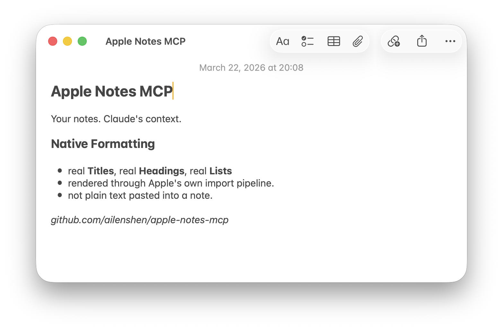

# Apple Notes MCP Server

[English](README.md) | 简体中文

让 Claude 读写你的 Apple 备忘录：**原生格式**、表格、附件，并通过 iCloud 同步。

[](https://glama.ai/mcp/servers/ailenshen/apple-notes-mcp)

Claude 改备忘录的方式和你自己改一样：只改一行字、勾一个待办，备忘录的其余部分原样不动，颜色、字体都不会丢。标题、小标题、列表、待办清单、表格和高亮，用的都是备忘录自己的样式。Claude 还能看懂备忘录里的图片、扫描件和 PDF，也能帮你整理文件夹。

<picture>
  <source media="(prefers-color-scheme: dark)" srcset="assets/screenshot-dark.png">
  <source media="(prefers-color-scheme: light)" srcset="assets/screenshot-light.png">
  
</picture>

**要求：** macOS 26（Tahoe）或更新版本，[Node.js](https://nodejs.org/) 24+，以及 Claude Code、Claude Desktop（包括 Cowork 和 Code 会话）或 claude.ai。其他 MCP 客户端也能用：它支持 MCP 2026-07-28，也支持较早的 `initialize` 握手（2024-11-05 至 2025-11-25）

## 安装

### 1. 添加到 Claude

**Claude Code**：在终端运行

```bash
claude mcp add apple-notes -- npx -y @ailenshen/apple-notes-mcp@latest
```

**Claude Desktop**：把下面内容加到 `~/Library/Application Support/Claude/claude_desktop_config.json`，然后重启 Claude：

```json
{
  "mcpServers": {
    "apple-notes": {
      "command": "npx",
      "args": ["-y", "@ailenshen/apple-notes-mcp@latest"]
    }
  }
}
```

**claude.ai**（网页和手机）：见[远程访问](#远程访问)。

`@latest` 会让它自动更新：每次 Claude 启动服务时，npx 都会检查有没有新版本，有就先下载。

### 2. 授予权限

第一次需要时会自动弹出设置窗口（也可以运行 `npx -y @ailenshen/apple-notes-mcp@latest setup`）。为 **Apple Notes MCP** 打开两个开关：

| 权限 | 用途 |
|-----|-----|
| **完全磁盘访问权限** | 读取你的备忘录 |
| **自动化 → 备忘录** | 把修改同步到 iCloud，移动和删除备忘录 |

只需要设置一次，以后更新版本也不用重新授权。

### 3. 开始使用

直接和 Claude 说就行：

- "我这周在备忘录里改了什么？"
- "在购物清单里把牛奶勾掉，再加上鸡蛋"
- "给会议记录加一节'下一步'"
- "我的收据备忘录里那张照片上写的是什么？"
- "把海南旅行的备忘录都移到'旅行'文件夹"
- "给'工作'里的每篇备忘录写一句话描述"
- "把'旧项目'文件夹归档到 ~/Documents/Archive/old-projects.zip，然后删掉它"

## 能做什么

| 工具 | 说明 |
|-----|-----|
| `overview` | 列出文件夹，或列出备忘录及其大小和一句话描述；可按日期筛选，按日期或标题排序 |
| `search` | 全文搜索，并显示匹配的文字 |
| `read_note` | 以 Markdown 读取备忘录：按 id 或标题，一次读多篇，或只读其中一节 |
| `read_attachment` | 查看备忘录里的图片、扫描件、PDF、视频、表格或文件 |
| `create_note` | 用 Markdown 新建备忘录 |
| `edit_note` | 修改文字、在某个标题下添加内容，或整篇重写；一次可以改多处 |
| `describe_note` | 保存一句话描述，可一次保存多篇 |
| `move_note` | 把备忘录移到其他文件夹，或从"最近删除"中恢复 |
| `manage_folder` | 新建、重命名或删除文件夹；把文件夹导出到磁盘（Markdown 加附件原文件，可直接打包成 .zip），或连同里面的内容一起删除 |
| `delete_note` | 移到"最近删除" |

Claude 不会覆盖你自己的修改：如果备忘录在 Claude 读取之后被改过，写入会被拒绝。每次修改前都会先备份备忘录。

### 备忘录格式与 Markdown 的对应

| 备忘录 | Markdown |
|-------|----------|
| 标题 / 小标题 / 副标题 | `#` / `##` / `###` |
| 圆点、短横线、编号列表 | `*` / `-` / `1.` |
| 待办清单 | `- [ ]` / `- [x]` |
| 引用、等宽 | `>`、```` ``` ```` |
| 粗体、斜体、删除线 | `**…**`、`*…*`、`~~…~~` |
| 下划线、高亮 | `<u>…</u>`、`<mark>…</mark>` |
| 链接、表格 | `[文字](url)`、`\| a \| b \|` |

## 远程访问

服务通过 stdio 通信。要在 claude.ai 上使用，需要放在一个把 HTTP 请求转发到 stdio 的桥接程序后面，再把它的地址添加为自定义连接器。

## 从 1.x 升级

第 2 版用 Swift 重写，`@latest` 会自动装上它。变化如下：

- 需要 macOS 26（Tahoe）。旧版 macOS 请继续用第 1 版：`npx -y @ailenshen/apple-notes-mcp@1`。
- 权限现在授予 **Apple Notes MCP** 这个 app。设置窗口会弹出一次，打开两个开关即可。
- 重启一次 Claude，或重新连接一次连接器。
- `--http` 模式已移除，见[远程访问](#远程访问)。如果还要用它，请继续用 `@1`。

## 工作原理

- **读取**通过备忘录自己的数据框架进行，只读。
- **写入**只改有变化的部分，通过备忘录自己的编辑对象完成，所以备忘录的其余部分（包括 Markdown 表达不了的格式）都不受影响。
- **同步**：每次修改后，都会请备忘录把它上传到 iCloud。
- 备忘录 app 不会跳到前台，也不会弹出任何对话框。

## 已知限制

- 附件可以读取，但不能添加或删除。
- 暂时不能移动文件夹。
- 无法读取上锁的备忘录；导出时会把它们列为"未导出"。共享的备忘录可以编辑，但不能删除。
- 如果你刚在备忘录里编辑过某个表格，Claude 再修改它时会重建这个表格，表格单元格里的格式会被重置。

## 愿景

在苹果设备上，备忘录是保存个人知识最自然的地方：到处同步、速度快、注重隐私。但它是一座没有 API 的围墙花园。

这个项目要让 Apple 备忘录成为 AI 的一等数据源。长期目标是：无论你在哪里和 AI 对话，在 Mac 上、手机上还是网页上，你的 Apple 备忘录都能随时被读取和写入。

## 许可证

MIT
